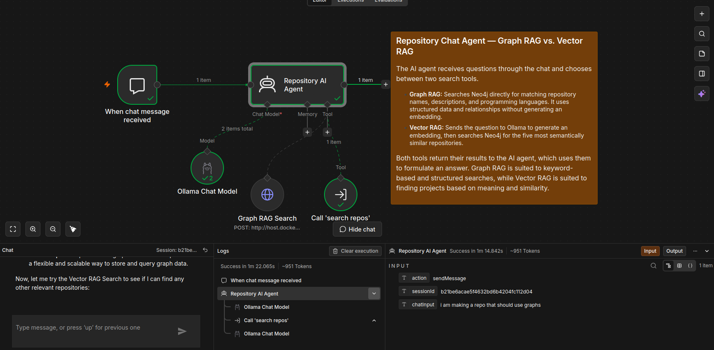

# RepoAgent

RepoAgent is an AI repository assistant built with n8n, Neo4j and Ollama. It combines Graph RAG and Vector RAG to find relevant repositories based on their metadata and semantic similarity.

## Embed


The workflow retrieves public repositories from the GitHub API:

`https://api.github.com/users/nikholt1/repos`

It filters repositories that have a description and programming language, then merges them with a hardcoded list of private repositories that cannot be retrieved through the public API.

The data is normalized into a consistent format containing the repository name, description and languages.

**Graph RAG:** The workflow connects to Neo4j and creates `Repository` and `Language` nodes, connecting them through `USES_LANGUAGE` relationships.

**Vector RAG:** The workflow sends the repository information to Ollama using `nomic-embed-text`. Ollama generates a 768-dimensional embedding, which is stored on the corresponding repository node in Neo4j.

Workflow: [`graphAndVectorEmbedding.json`](graphAndVectorEmbedding.json)

## Agent


The agent has a system prompt requiring it to attempt both search tools before answering:

- **Graph RAG Search:** Connects directly to Neo4j and searches repository names, descriptions and programming languages.
- **Vector RAG Search:** Calls the published `search repos` workflow to embed the question and retrieve semantically similar repositories.

The system prompt also instructs the agent to use the retrieved results, avoid inventing repository information, and disclose when a search fails or returns insufficient information.

Workflow: [`embedAgent.json`](embedAgent.json)

## Published workflow — Vector search


When the agent calls the Vector RAG tool, it passes the user's question to the published `search repos` workflow.

The workflow sends the question to Ollama using `nomic-embed-text` and validates that the resulting embedding contains 768 values.

It then queries Neo4j's `repository_embedding_index` and retrieves the five closest repository matches based on vector similarity. The results are formatted and returned to the agent.

Workflow: [`publishedSearchRepos.json`](publishedSearchRepos.json)


## Data sources and Neo4j

### Data sources

- **Public GitHub repositories:** Retrieved from the GitHub API for `nikholt1`. Only repositories with a description and programming language are included.
- **Private repositories:** A hardcoded list in the ingestion workflow containing `Magistra3.0`, `TraceAI`, `RAG-Project` and `Self-Hosted-AI`.
- **Ollama:** Generates repository and query embeddings locally using `nomic-embed-text`, and provides the chat model `Llama3.2:latest`.
- **Neo4j:** Stores repository metadata, language relationships and embeddings.

### Graph relationships


The graph uses two node types:

- `Repository`: stores the repository name, description, languages and embedding.
- `Language`: stores programming language names.

Each repository connects to its languages through `USES_LANGUAGE` relationships.

### Vector embeddings


Each repository has an `embedding` property containing 768 numerical values. The vector index `repository_embedding_index` is used to find repositories similar to an embedded query.

## Examples
1. Small prompt causes error

When the prompt is too small, it seems like the agent fails to retrieve the GRAPH RAG, for some reason it does not see the necessity to call the VECTOR RAG at all.
The error message states that the database might be offline, and i get a error code 400.
**prompt**

```
i am making a repo that should use graphs 
```


2. Explicitely ask for GRAPH and VECTOR RAG results

The prompt explicitely states that the agent should use the Graph Rag and the Vector RAG but the agent determines only the need for the Vector RAG
**promp**

```
i am making a repo that should use graphs use both Graph Rag Search the Vector Rag and Search all repos tools to determine the best answers
```


3. Both RAG success prompt

The prompt states that the agent should like "2." prompt use the Vector and the Graph RAG, but more explicitely tells it to search for specific cases. This might have caused the agent to evaluate the responses more carefully and set its threshold for compatibility of the repos, so how similar they are in the Graph RAG, for it to then look for the Vector RAG to get a more refined answer.
BUT we still got an error message even though it was a success
**promp**

```
I am creating a repository that will use graphs, and i want to find existing repositories or implementations that make it quick and easy to integrate and work with graphs. Search my repositories using both Graph RAG and Vector RAG to identify relevant projects, libaries or reusable code that could help me implement graph functionality with minimal setup and boilerplate Recommend the most relevannt options and explain briefly what i could reuse from each.
```


4. Both RAG success and system response

We used the same prompt as in example 3. and this time the LLM responded with text.


## Data Sources
### EmbedAgent.json

The agent receives user questions through the n8n chat trigger and uses Ollama's `Llama3.2:latest` model to generate answers.

It has two tools:
- **Graph RAG Search:** Queries Neo4j for matching repositories and their languages.
- **Vector RAG Search:** Calls `publishedSearchRepos.json` to embed the query with `nomic-embed-text` and retrieve similar repositories.

The system prompt instructs the agent to attempt both tools before answering and to base its responses on the retrieved data.

### graphAndVectorEmbedding.json

The workflow retrieves public repositories from the GitHub API and combines them with a hardcoded list of private repositories. It then normalizes and deduplicates the data.

- **Graph RAG:** Creates `Repository` and `Language` nodes in Neo4j and connects them using `USES_LANGUAGE` relationships.
- **Vector RAG:** Sends repository descriptions and languages to Ollama using `nomic-embed-text`, then stores the 768-dimensional embeddings on the repository nodes in Neo4j.

The workflow can be run manually, with an optional daily schedule trigger.

**Gather + Normalize Repository Data Node**
```javascript

const byName = new Map();

for (const item of $input.all()) {
  const repo = item.json || {};

  if (!repo.name) continue;

  const name = String(repo.name).trim();
  const description =
    typeof repo.description === 'string'
      ? repo.description.trim()
      : '';

  const languages = Array.isArray(repo.languages)
    ? repo.languages.filter(
        x => typeof x === 'string' && x.trim()
      )
    : [];

  const existing = byName.get(name);

  if (!existing) {
    byName.set(name, {
      name,
      description,
      languages: [...new Set(languages)]
    });
  } else {
    if (description.length > existing.description.length) {
      existing.description = description;
    }

    existing.languages = [
      ...new Set([...existing.languages, ...languages])
    ];
  }
}

return [...byName.values()].map(repo => ({
  json: {
    ...repo,
    text: [
      `Repository: ${repo.name}`,
      `Description: ${repo.description || ''}`,
      `Languages: ${repo.languages.join(', ')}`
    ].join('\n')
  }
}));
```
this outputs: 
for example: 

``
Repository: SimpleFastPost
Description: HTTP tester with Spring Boot, SQLite, WebSockets and data connectors.
Languages: Java, JavaScript, SQL
`` 
## neo4J
Most of the data configuration happens in the workflow, as seen in datasources under **Gather + Normalize Repository Data Node**
This was not in the consideration of the workflow, but i think it fell naturally, since I may have subconsciously avoided the queries given i dont know cypher

1. To find and visualize the Graph RAG i used the query:
```
MATCH (a)-[r]->(b)
RETURN a, r, b
LIMIT 100;
```

2. To see the entities in the Vector RAG i used:
```
MATCH (r:Repository)
RETURN
    r.name AS name,
    r.description AS description,
    r.languages AS languages,
    r.embedding IS NOT NULL AS hasEmbedding,
    size(r.embedding) AS embeddingDimensions;
```

## Setup
1. Setup neo4j to hold a instance with a database
2. Setup n8n in docker
3. import `embedAgent.json`, `graphAndVectorEmbedding.json` and `publishedSearchRepos.json` into your workflows

4. Change the URL in the `Fetch public github repositories` node in the `graphAndVectorEmbedding.json` workflow
5. Run the `graphAndVectorEmbedding.json` to make neo4j have the correctly embedded data
6. now you can use the `embedAgent.json` workflow to prompt the ollama LLM

**Note:** Make sure Neo4j, n8n, and Ollama are configured correctly and can communicate with each other. You must have the required Ollama models (llama3.2 and nomic-embed-text) installed, configure the necessary URLs and credentials, and ensure the vector index is created before running the repository search workflow.
