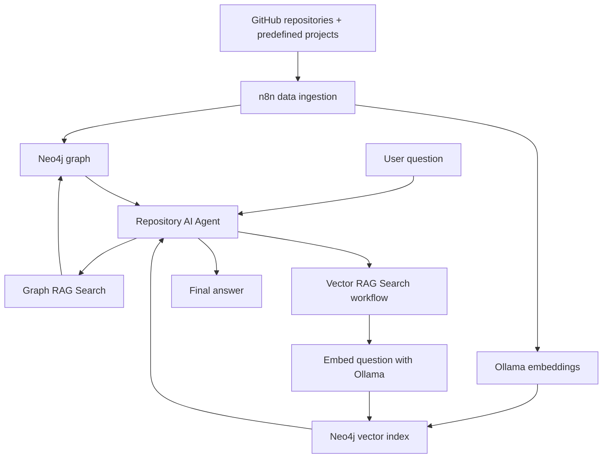
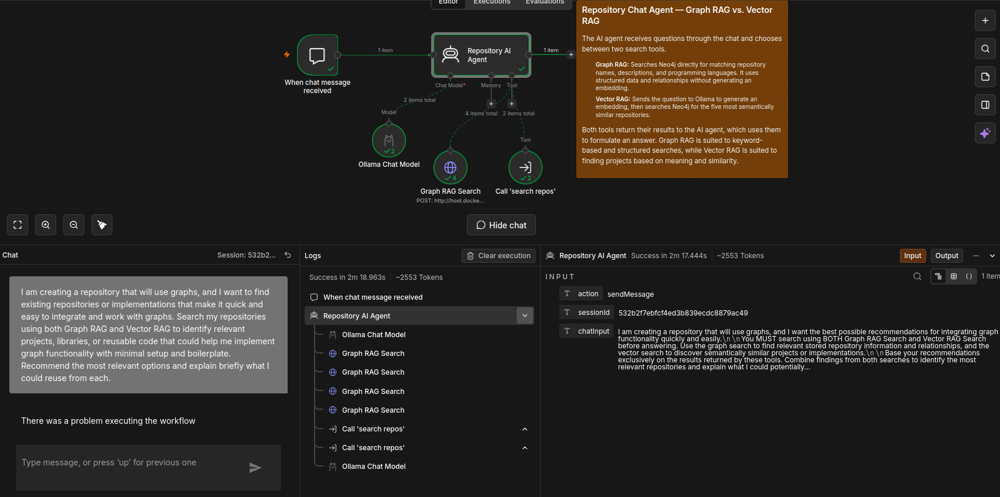

# RepoAgent — Graph RAG + Vector RAG

RepoAgent is an AI-powered repository assistant built with **n8n, Neo4j and Ollama**. It helps users discover relevant software repositories by searching repository metadata and comparing semantic similarity between project descriptions.

The system combines two retrieval methods:

- **Graph RAG:** searches structured repository information, including names, descriptions, programming languages and their relationships.
- **Vector RAG:** embeds a user's question and searches for repositories with semantically similar embeddings.

The AI agent combines the results to answer questions and recommend potentially reusable projects.

## Architecture



## 1. Workflows and screenshots

### Data ingestion — Graph and Vector Embedding


The `graphAndVectorEmbedding.json` workflow retrieves public GitHub repository metadata and combines it with a predefined list of projects. It normalizes the data and processes it through two branches:

1. **Graph branch:** creates or updates repository and language nodes and their relationships in Neo4j.
2. **Vector branch:** sends repository descriptions and metadata to Ollama, validates the 768-dimensional embeddings, and stores them on the corresponding repository nodes.

The workflow can be run manually. An optional schedule trigger is configured for daily execution but is disabled in the exported workflow.

**Workflow export:** [`graphAndVectorEmbedding.json`](graphAndVectorEmbedding.json)

### Vector RAG — Embed a question and retrieve repositories


The `publishedSearchRepos.json` workflow receives a query from the agent, generates an embedding using `nomic-embed-text`, and queries Neo4j's `repository_embedding_index`.

The workflow requests the five closest repository matches and formats the returned metadata for the agent.

**Workflow export:** [`publishedSearchRepos.json`](publishedSearchRepos.json)

### Repository AI Agent — Graph RAG + Vector RAG



The `embedAgent.json` workflow receives chat messages and passes them to an AI agent using `Llama3.2:latest`.

The agent has two search tools:

- **Graph RAG Search:** searches Neo4j for matching repository names, descriptions and programming languages, including language relationships.
- **Vector RAG Search:** calls the published search workflow to embed the question and retrieve semantically similar repositories.

The agent instructions require both tools to be attempted for every repository-related question before the final answer is generated.

**Workflow export:** [`embedAgent.json`](embedAgent.json)

## 2. Agent configuration and prompts

### Model configuration

| Component | Configuration |
|---|---|
| Chat model | `Llama3.2:latest` |
| Embedding model | `nomic-embed-text` |
| Embedding dimensions | 768 |
| Graph database | Neo4j |
| Workflow automation | n8n |
| Vector index | `repository_embedding_index` |

### System prompt

```text
You are a repository assistant with access to two search tools:
Graph RAG Search and Vector RAG Search.

MANDATORY TOOL USAGE:

For every repository-related question or request for
recommendations, you MUST call BOTH Graph RAG Search AND
Vector RAG Search before answering.

Graph RAG Search retrieves repository information using
matching names, descriptions, programming languages, and
stored relationships.

Vector RAG Search retrieves repositories based on semantic
similarity to the user's request.

Always search with both tools. Do not skip either tool,
even if the first tool returns sufficient results.
Wait for both tool results before formulating your answer.

Base factual claims about stored repositories exclusively
on information returned by the search tools.

Combine and compare both sets of results. Recommend
repositories and potential reuse only where supported
by the returned information.

Do not invent repository names, descriptions, programming
languages, relationships, implementation details, or
search results.

If one tool fails or returns no results, disclose this
and use the available results without pretending both
searches succeeded.

If the information is insufficient, explicitly state
what cannot be determined.

Do not answer a repository-related request until you
have attempted both search tools.
```

### Tool descriptions

**Graph RAG Search**

> Search the repository graph for matching repository names, descriptions, programming languages, and language relationships. Use this for exact or keyword-based questions. Input is a search phrase.

**Vector RAG Search**

> Embed the user's query and search Neo4j for the five most semantically similar repositories. Use this to discover projects that may be relevant even when their names or descriptions do not directly match the query.

The tool descriptions explain the intended roles of each search method. The system prompt establishes the requirement to attempt both tools.

## 3. Example questions and results

The following section should document three real executions of the agent. Include the question, both tool calls, the retrieved information, the actual final answer, and a brief assessment.

### Example 1 — Finding repositories by technology

**Question**

> Which repositories use Java, and what are they used for?

**Graph RAG tool call:** `[Insert actual tool input and output]`

**Vector RAG tool call:** `[Insert actual tool input and output]`

**Retrieved information:** `[Insert repository names, descriptions, languages and similarity scores where available]`

**Agent's actual answer**

> `[Paste the answer returned by the agent.]`

**Assessment:** `[Did the graph search find the expected Java repositories? Did vector search add relevant results?]`

### Example 2 — Finding similar projects

**Question**

> I want to build a graph-based application with a simple way to visualize and manipulate nodes and relationships. Which existing repositories could help?

**Graph RAG tool call:** `[Insert actual tool input and output]`

**Vector RAG tool call:** `[Insert actual tool input and output]`

**Retrieved information:** `[Insert actual results from both tools]`

**Agent's actual answer**

> `[Paste the answer returned by the agent.]`

**Assessment:** `[Were the recommendations relevant to the requested functionality? Was the agent able to identify useful projects beyond exact keyword matches?]`

### Example 3 — Limitation or failure

**Question**

> Which repository contains a complete production-ready implementation of `[a feature not documented in the repository data]`?

**Graph RAG tool call:** `[Insert actual tool input and output]`

**Vector RAG tool call:** `[Insert actual tool input and output]`

**Retrieved information:** `[Insert actual results, including empty results or irrelevant matches if applicable]`

**Agent's actual answer**

> `[Paste the answer returned by the agent.]`

**Assessment and limitation:** `[Explain whether the available metadata was sufficient. For example, repository descriptions and language tags alone cannot verify undocumented implementation details or whether a project is production-ready.]`

These examples should be replaced with actual execution records. Do not present illustrative answers as measured results.

## 4. Data sources and Neo4j structure

### Data sources

The ingestion workflow uses two sources:

1. **Public GitHub repositories:** retrieved from the GitHub user repositories API for `nikholt1`. The workflow filters out public repositories that lack a description or primary language.
2. **Predefined project records:** manually maintained entries for projects not returned by the public-repository endpoint, including private projects.

The workflow merges and deduplicates repository records by name before storing them.

### Graph model


The graph currently uses two node types and one relationship type.

| Element | Properties | Purpose |
|---|---|---|
| `Repository` | `name`, `description`, `languages`, `embedding` | Stores repository metadata and its vector representation |
| `Language` | `name` | Represents a programming language |
| `USES_LANGUAGE` | No properties defined in the workflow | Connects a repository to its programming languages |

The relationship is directed:

```text
(:Repository)-[:USES_LANGUAGE]->(:Language)
```

The `languages` property on a repository is also stored as an array, while individual language nodes and relationships support graph traversal.

### Example repository record

A representative record from the predefined ingestion data is:

```json
{
  "name": "Magistra3.0",
  "description": "Private information hub built with Spring Boot, SQLite, WebSockets and data connectors.",
  "languages": ["Java", "JavaScript", "SQL"]
}
```

After embedding, the repository node also contains an `embedding` property with 768 numeric values.

### Vector embeddings


Each repository's combined text contains its name, description and programming languages. Ollama converts this text into an embedding using `nomic-embed-text`, and the workflow stores the resulting vector on the repository node.

The vector-search workflow embeds a new user question using the same model and queries the `repository_embedding_index` for the five closest matches.

The screenshot shows the repository, embedding dimensions and the first ten embedding values. The full vector contains 768 values.

## 5. Setup and reproduction

### Prerequisites

- n8n with the workflow nodes used in the exports.
- A running Neo4j instance with a database named `repos`.
- Ollama accessible to n8n.
- The `llama3.2` chat model and `nomic-embed-text` embedding model.
- Neo4j credentials configured securely in n8n.

### Step 1 — Start Ollama and pull the models

```bash
ollama pull llama3.2
ollama pull nomic-embed-text
```

Make sure the Ollama API is reachable from n8n. The exported workflows currently use `host.docker.internal` to reach services from Docker.

### Step 2 — Prepare Neo4j

The workflow expects the Neo4j query endpoint to be reachable at:

```text
http://host.docker.internal:7474/db/repos/query/v2
```

Configure the endpoint and authentication for your own environment. Do not commit credentials to the repository.

Create the vector index before running vector retrieval. For Neo4j versions supporting the following vector-index syntax, use:

```cypher
CREATE VECTOR INDEX repository_embedding_index IF NOT EXISTS
FOR (r:Repository)
ON (r.embedding)
OPTIONS {
  indexConfig: {
    `vector.dimensions`: 768,
    `vector.similarity_function`: 'cosine'
  }
};
```

Check your installed Neo4j version and index status if the syntax differs or the index is not online.

### Step 3 — Import the workflows

Import the following JSON files into n8n:

- [`graphAndVectorEmbedding.json`](graphAndVectorEmbedding.json)
- [`publishedSearchRepos.json`](publishedSearchRepos.json)
- [`embedAgent.json`](embedAgent.json)

Review the credentials, endpoints, model settings and workflow references after import. The agent workflow references the search workflow by its n8n workflow ID, so ensure that the reference points to the imported search workflow in your instance.

### Step 4 — Populate the graph and embeddings

Execute the data-ingestion workflow. It will fetch public repository metadata, merge the predefined records, create or update the graph, generate embeddings and write them to Neo4j.

Verify that repository nodes have an `embedding` property containing 768 values and that the vector index is online before testing retrieval.

### Step 5 — Test the agent

Activate the relevant workflows, open the n8n chat interface and ask a repository-related question. Check the execution record to confirm that both Graph RAG Search and Vector RAG Search were attempted and inspect their returned results before assessing the final answer.

## 6. Limitations

- **Metadata coverage:** the assistant can only retrieve information available in its stored repository records. It does not inspect every source file in each repository.
- **Vector relevance:** semantically similar results are not necessarily the most technically suitable implementations.
- **Graph coverage:** the current graph primarily models repositories and programming-language relationships; it does not represent detailed code dependencies or function-level relationships.
- **Agent reliability:** instructions require both tools to be attempted, but actual execution logs are needed to verify that both tools ran successfully for a given question.
- **Private repository records:** some project metadata is maintained manually, so descriptions can become outdated if not updated.

## Repository files

| File | Purpose |
|---|---|
| `embedAgent.json` | Chat agent and search-tool connections |
| `publishedSearchRepos.json` | Query embedding and vector retrieval |
| `graphAndVectorEmbedding.json` | Repository ingestion, graph creation and embedding storage |
| `assets/agent.png` | Agent workflow screenshot |
| `assets/embedNewDataAndGetSavedData.png` | Vector retrieval workflow screenshot |
| `assets/embedding2.png` | Data-ingestion workflow screenshot |
| `assets/graphRelationship.png` | Neo4j graph structure screenshot |
| `assets/vetorembeddings2.png` | Example stored vector embeddings |

---

**Security note:** Before publishing or sharing the workflow exports, remove hardcoded database authentication values and use n8n credentials or another secure configuration mechanism. If real credentials have already been published, rotate them.
