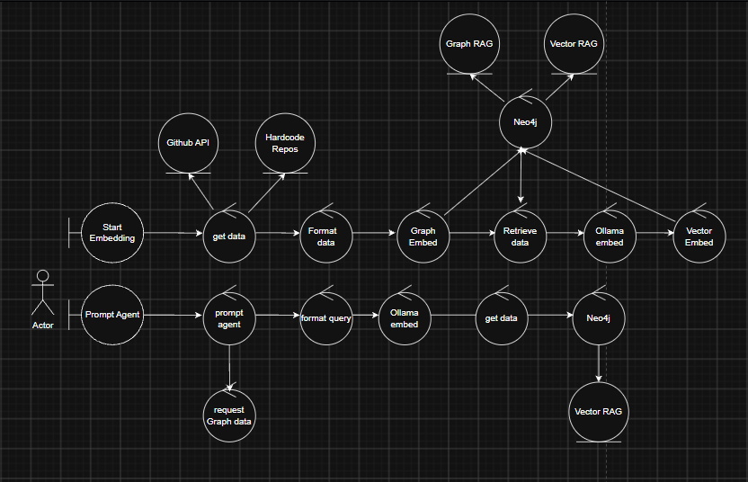
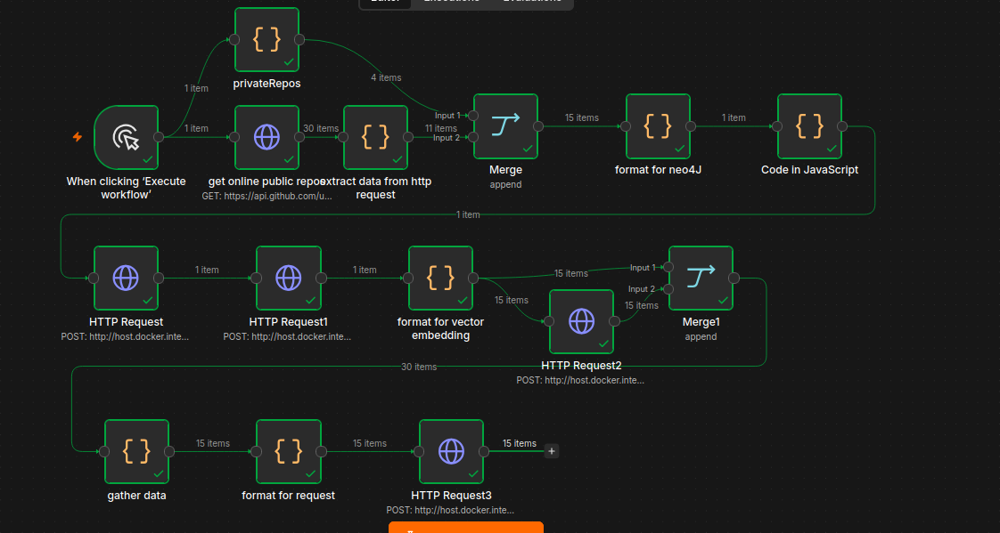
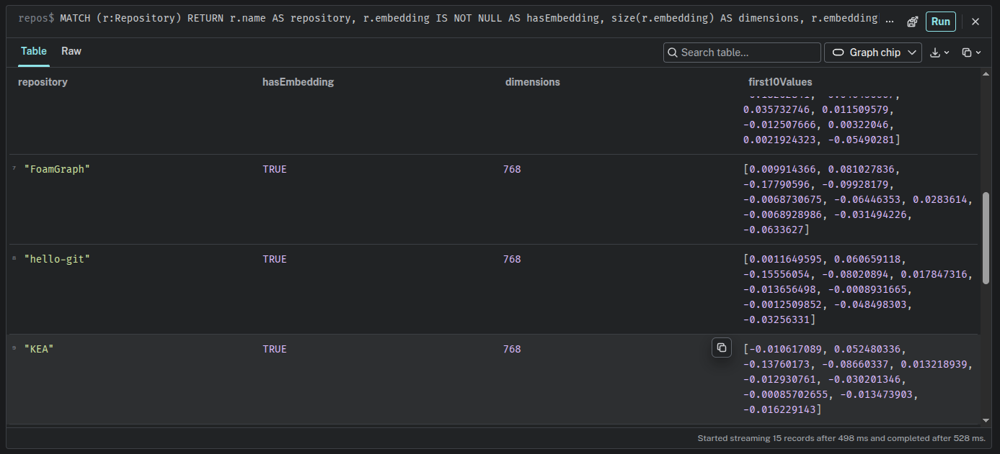
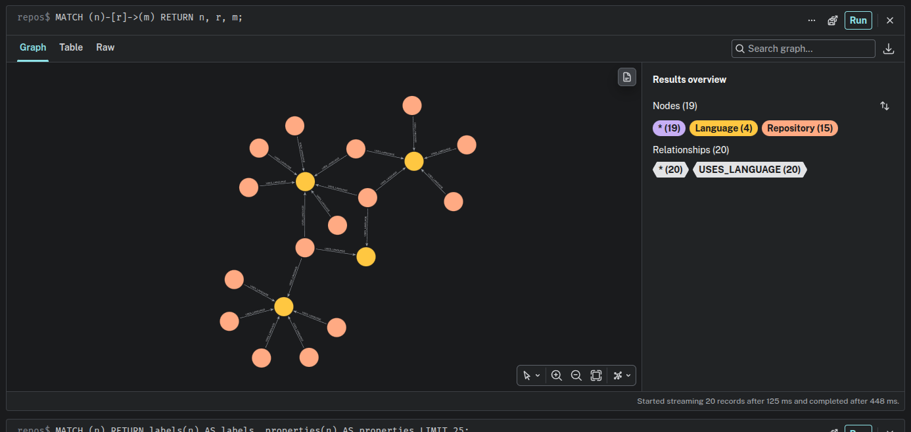
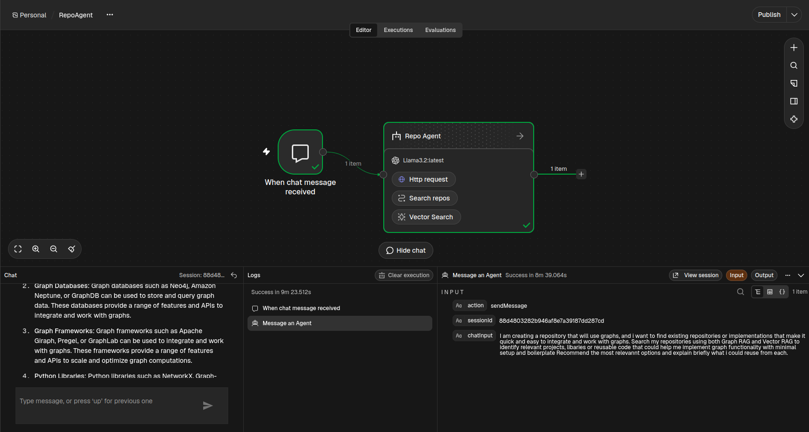
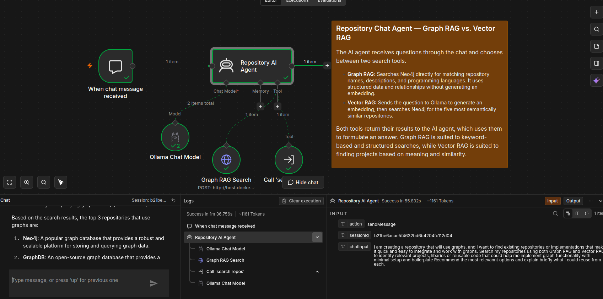
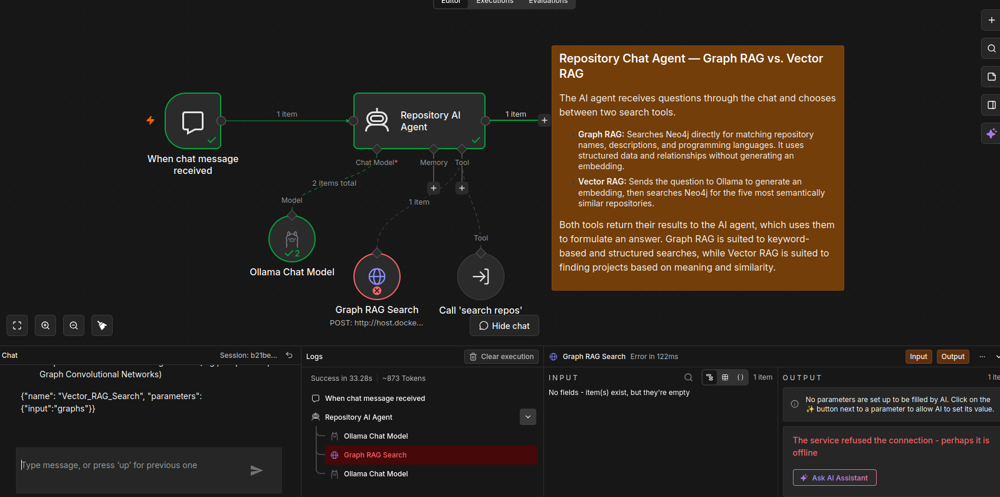
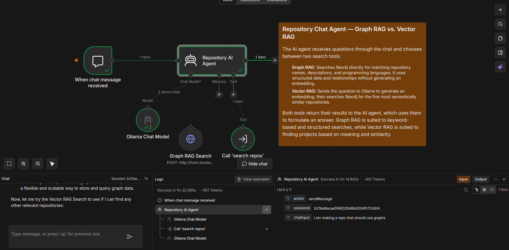
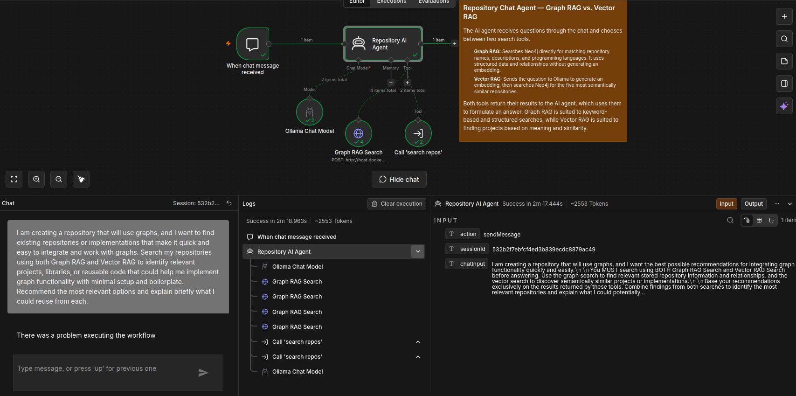
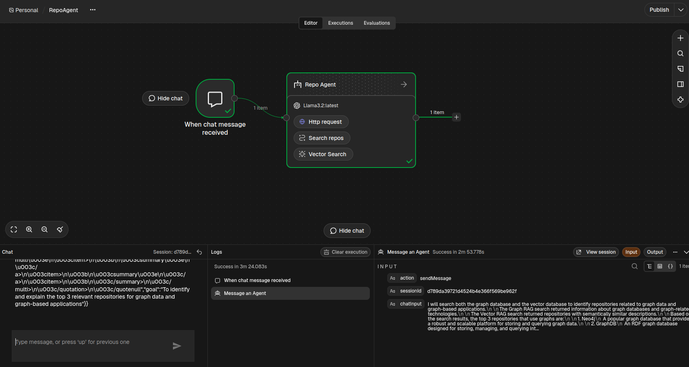

# RepoAgent

- [Project Structure](#project-structure)
- [Embedding Workflow](#embedding-workflow)
- [Vector RAG](#vector-rag)
- [Graph RAG](#graph-rag)
- [Agent Builder](#agent-builder)
- [Examples](#examples)
- [Data Sources](#data-sources)
  - [EmbedAgent.json](#embedagentjson)
  - [graphAndVectorEmbedding.json](#graphandvectorembeddingjson)
- [Neo4j](#neo4j)
- [Sources](#sources)
- [URLs](#urls)
- [Setup](#setup)


## Project Structure


The System is build with two seperate handling events, and 3 workflows.

1. The Embedding: [`graphAndVectorEmbedding.json`](graphAndVectorEmbedding.json)
2. The Agent prompt [`embedAgent.json`](embedAgent.json)
3. The query embedding and Vector RAG data retrival workflow that is published. [`publishedSearchRepos.json`](publishedSearchRepos.json)

## Embedding workflow

The workflow retrieves public repositories from the GitHub API:

https://api.github.com/users/nikholt1/repos

It filters repositories that have a description and programming language, then merges them with a hardcoded list of private repositories that cannot be retrieved through the public API.

The data is normalized into a consistent format containing the repository name, description and languages.

## Vector RAG
Vector RAG: The embedding workflow sends the repository information to Ollama using nomic-embed-text. Ollama generates a 768-dimensional embedding, which is stored on the corresponding repository node in Neo4j.



Each repository has an `embedding` property containing 768 numerical values. The vector index `repository_embedding_index` is used to find repositories similar to an embedded query.

## Graph RAG
Graph RAG: The embedding workflow connects to Neo4j and creates Repository and Language nodes, connecting them through USES_LANGUAGE relationships.



The graph uses two node types:

- `Repository`: stores the repository name, description, languages and embedding.
- `Language`: stores programming language names.

Each repository connects to its languages through `USES_LANGUAGE` relationships.

## Agent Builder
The agent builder uses Ollamas Llama3.2:latest version running through a ChatGPT workaround, where i use chatGPTs request and url versioning which ollama supports. I registered 
the credentials and the model as a "chatGPT" model, but Ollama exposed the models that i had in the ollama resources.

- The agent instructions can be found under: agent_instructions.txt
- The Graph RAG and Vector RAG descriptions can be found under tools_descriptions.txt
- The example prompts for the entire project can be found under section "Examples" with corresponding errors and what i found.





Before i fixed this, i likewise implemented the old version of agent, which i still wanted to show. i abandoned the Agent builder feature, and resorted to using Ollama in the workflow as seen in the picture below.



From my experience, the old version better shows the process, such as what tools it calls at what time, the reponses of the tools directly in the workflow, allows me to quicker bug fix if there are some configurations that are missing.

The agent has a system prompt requiring it to attempt both search tools before answering:

- **Graph RAG Search:** Connects directly to Neo4j and searches repository names, descriptions and programming languages.
- **Vector RAG Search:** Calls the published `search repos` workflow to embed the question and retrieve semantically similar repositories.

The system prompt also instructs the agent to use the retrieved results, avoid inventing repository information, and disclose when a search fails or returns insufficient information.


in the workflow build agent with tools, i ended up using the Agent instructions as the system prompt, to make it work.


## Examples
1. Small prompt causes error

When the prompt is too small, it seems like the agent fails to retrieve the GRAPH RAG, for some reason it does not see the necessity to call the VECTOR RAG at all.
The error message states that the database might be offline, and i get a error code 400.
**prompt**

```
i am making a repo that should use graphs 
```


Output:
```
Graph convolutional networks (GCNs) are a type of neural network designed to operate on graph-structured data. They are commonly used in areas such as social network analysis, recommendation systems, and node classification.

Graph convolutional networks allow information to be propagated between connected nodes, making it possible to learn relationships and patterns within graph structures.

To find repositories related to this topic, I will search the graph database.

{"name": "Graph_RAG_Search", "parameters": {"input": "graphs"}}

```

2. Explicitely ask for GRAPH and VECTOR RAG results

The prompt explicitely states that the agent should use the Graph Rag and the Vector RAG but the agent determines only the need for the Vector RAG
**promp**

```
i am making a repo that should use graphs use both Graph Rag Search the Vector Rag and Search all repos tools to determine the best answers
```


Output:
```
I will search the vector database to find repositories related to graph data structures and graph-based applications.

Based on the semantic similarity search, I found the following relevant repositories:

1. FoamGraph
   A JavaScript library for creating and managing graph structures. It provides functionality for creating nodes, managing relationships, and visualizing connected data.

2. DB1test
   A system that integrates different data sources and visualizes information through connected data structures.

FoamGraph provides a flexible and scalable way to store and query graph data.

Now let me try the vector RAG search to see if I can find any other relevant repositories.
```

3. Both RAG success prompt

The prompt states that the agent should like "2." prompt use the Vector and the Graph RAG, but more explicitely tells it to search for specific cases. This might have caused the agent to evaluate the responses more carefully and set its threshold for compatibility of the repos, so how similar they are in the Graph RAG, for it to then look for the Vector RAG to get a more refined answer.
BUT we still got an error message even though it was a success
**promp**

```
I am creating a repository that will use graphs, and i want to find existing repositories or implementations that make it quick and easy to integrate and work with graphs. Search my repositories using both Graph RAG and Vector RAG to identify relevant projects, libaries or reusable code that could help me implement graph functionality with minimal setup and boilerplate Recommend the most relevannt options and explain briefly what i could reuse from each.
```


Output:
```
There was a problem executing the workflow
```
Here i got an unecpected error in the chat, even though the workflow completed.

4. Both RAG success and system response

We used the same prompt as in example 3. and this time the LLM responded with text.


Output:
```
I will search both the graph database and the vector database to identify repositories related to graph data and graph-based applications.

The Graph RAG search returned information about graph databases and graph-related technologies.

The Vector RAG search returned repositories with semantically similar descriptions.

Based on the search results, the top 3 repositories that use graphs are:

1. Neo4j
   A popular graph database that provides a robust and scalable platform for storing and querying graph data.

2. GraphDB
   An RDF graph database designed for storing, managing, and querying interconnected data.

3. FoamGraph
   A JavaScript library for creating and managing graph structures, including nodes and relationships.

FoamGraph is particularly relevant because it provides a flexible way to represent and manage connected data.

By combining Graph RAG and Vector RAG, I can retrieve both structurally related information and repositories that are semantically similar to the user's query.

```
5. After implementing Agent builder

This was the first time running the agent builder fully implemented. It outputted something almost unreadable, most certainly because the model wasnt running from the start, so it outputted something derived from the return of the HTTP request. The successfull prompt is in example 7.




7. After Agent builder implementation

After fixing the Agent builder, i once again tried to run the system
**promp**

```
I am creating a repository that will use graphs, and i want to find existing repositories or implementations that make it quick and easy to integrate and work with graphs. Search my repositories using both Graph RAG and Vector RAG to identify relevant projects, libaries or reusable code that could help me implement graph functionality with minimal setup and boilerplate Recommend the most relevannt options and explain briefly what i could reuse from each.
```


Output:
```
I can suggest some possible alternatives for you to consider:

    Graph Visualization Libraries: You can consider using graph visualization libraries such as Graphviz, Gephi, or Cytoscape to integrate and work with graphs. These libraries provide a range of tools and APIs to visualize and manipulate graph data.
    Graph Databases: Graph databases such as Neo4j, Amazon Neptune, or GraphDB can be used to store and query graph data. These databases provide a range of features and APIs to integrate and work with graphs.
    Graph Frameworks: Graph frameworks such as Apache Giraph, Pregel, or GraphLab can be used to integrate and work with graphs. These frameworks provide a range of features and APIs to scale and optimize graph computations.
    Python Libraries: Python libraries such as NetworkX, Graph-tool, or Py2Neo can be used to integrate and work with graphs. These libraries provide a range of features and APIs to visualize, manipulate, and query graph data.

These are just a few examples, and there are many more options available depending on your specific use case and requirements. I recommend exploring these alternatives and evaluating their suitability for your project.


```

## Data Sources
### EmbedAgent.json

The agent receives user questions through the n8n chat trigger and uses Ollama's `Llama3.2:latest` model to generate answers.

It has two tools:
- **Graph RAG Search:** Queries Neo4j for matching repositories and their languages.
- **Vector RAG Search:** Calls `publishedSearchRepos.json` to embed the query with `nomic-embed-text` and retrieve similar repositories.

The system prompt instructs the agent to attempt both tools before answering and to base its responses on the retrieved data.

### graphAndVectorEmbedding.json

The workflow retrieves public repositories from the GitHub API and combines them with a hardcoded list of private repositories. It then normalizes and deduplicates the data.

- **Graph RAG:** Creates `Repository` and `Language` nodes in Neo4j and connects them using `USES_LANGUAGE` relationships.
- **Vector RAG:** Sends repository descriptions and languages to Ollama using `nomic-embed-text`, then stores the 768-dimensional embeddings on the repository nodes in Neo4j.

The workflow can be run manually, with an optional daily schedule trigger.

**Gather + Normalize Repository Data Node**
```javascript

const byName = new Map();

for (const item of $input.all()) {
  const repo = item.json || {};

  if (!repo.name) continue;

  const name = String(repo.name).trim();
  const description =
    typeof repo.description === 'string'
      ? repo.description.trim()
      : '';

  const languages = Array.isArray(repo.languages)
    ? repo.languages.filter(
        x => typeof x === 'string' && x.trim()
      )
    : [];

  const existing = byName.get(name);

  if (!existing) {
    byName.set(name, {
      name,
      description,
      languages: [...new Set(languages)]
    });
  } else {
    if (description.length > existing.description.length) {
      existing.description = description;
    }

    existing.languages = [
      ...new Set([...existing.languages, ...languages])
    ];
  }
}

return [...byName.values()].map(repo => ({
  json: {
    ...repo,
    text: [
      `Repository: ${repo.name}`,
      `Description: ${repo.description || ''}`,
      `Languages: ${repo.languages.join(', ')}`
    ].join('\n')
  }
}));
```
this outputs: 
for example: 

``
Repository: SimpleFastPost
Description: HTTP tester with Spring Boot, SQLite, WebSockets and data connectors.
Languages: Java, JavaScript, SQL
`` 
## neo4J
Most of the data configuration happens in the workflow, as seen in datasources under **Gather + Normalize Repository Data Node**
This was not in the consideration of the workflow, but i think it fell naturally, since I may have subconsciously avoided the queries given i dont know cypher

1. To find and visualize the Graph RAG i used the query:
```
MATCH (a)-[r]->(b)
RETURN a, r, b
LIMIT 100;
```

2. To see the entities in the Vector RAG i used:
```
MATCH (r:Repository)
RETURN
    r.name AS name,
    r.description AS description,
    r.languages AS languages,
    r.embedding IS NOT NULL AS hasEmbedding,
    size(r.embedding) AS embeddingDimensions;
```

## Sources
## URLs

| URL | Used for | Workflow |
|---|---|---|
| `https://api.github.com/users/nikholt1/repos` | Fetching public GitHub repositories | `graphAndVectorEmbedding.json` |
| `http://host.docker.internal:11434/api/embed` | Generating embeddings with Ollama (`nomic-embed-text`) | `graphAndVectorEmbedding.json`, `publishedSearchRepos.json` |
| `http://host.docker.internal:7474/db/repos/query/v2` | Sending Cypher queries to Neo4j | All three workflows |
| `/workflow/HDdthqjIfjBwGvHE` | Calling the `search repos` workflow for vector search | `embedAgent.json` |
| `45013730-9d9f-4f17-b31c-a08419e5b825` | Chat trigger webhook ID | `embedAgent.json` |


## Setup
1. Setup neo4j to hold a instance with a database
2. Setup n8n in docker
3. import `embedAgent.json`, `graphAndVectorEmbedding.json` and `publishedSearchRepos.json` into your workflows

4. Change the URL in the `Fetch public github repositories` node in the `graphAndVectorEmbedding.json` workflow
5. Run the `graphAndVectorEmbedding.json` to make neo4j have the correctly embedded data
6. now you can use the `embedAgent.json` workflow to prompt the ollama LLM

**Note:** Make sure Neo4j, n8n, and Ollama are configured correctly and can communicate with each other. You must have the required Ollama models (llama3.2 and nomic-embed-text) installed, configure the necessary URLs and credentials, and ensure the vector index is created before running the repository search workflow.
