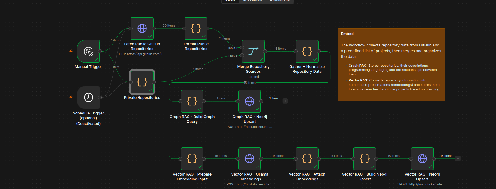
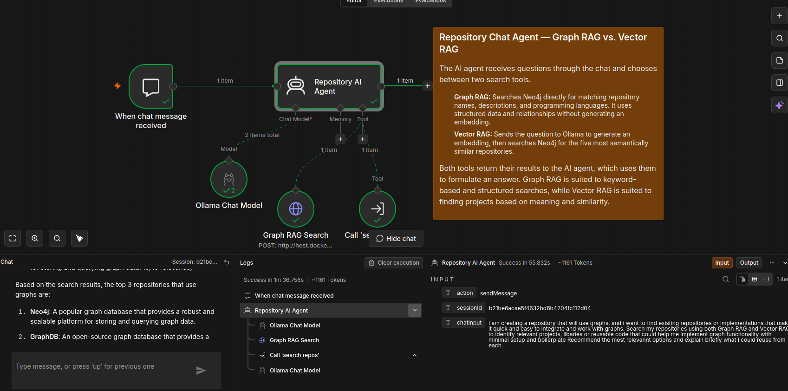
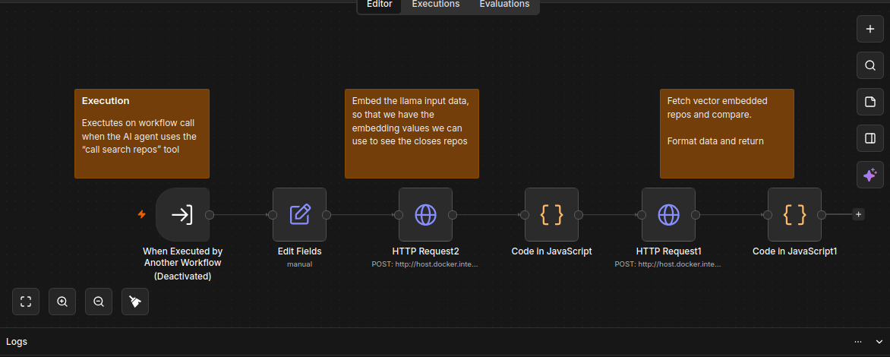
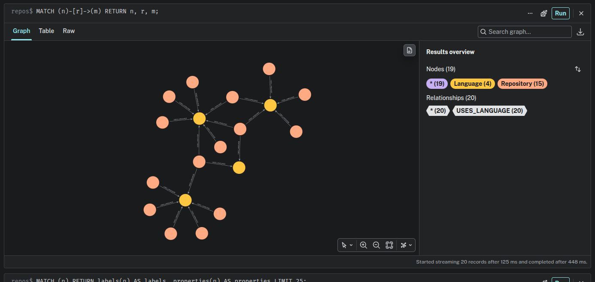
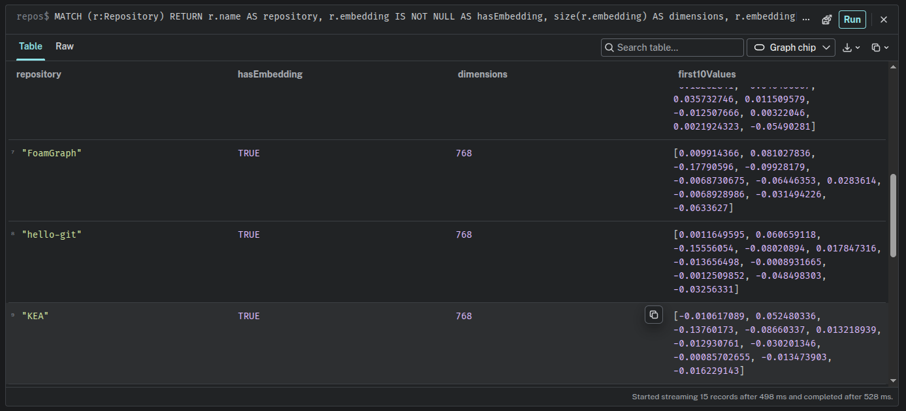
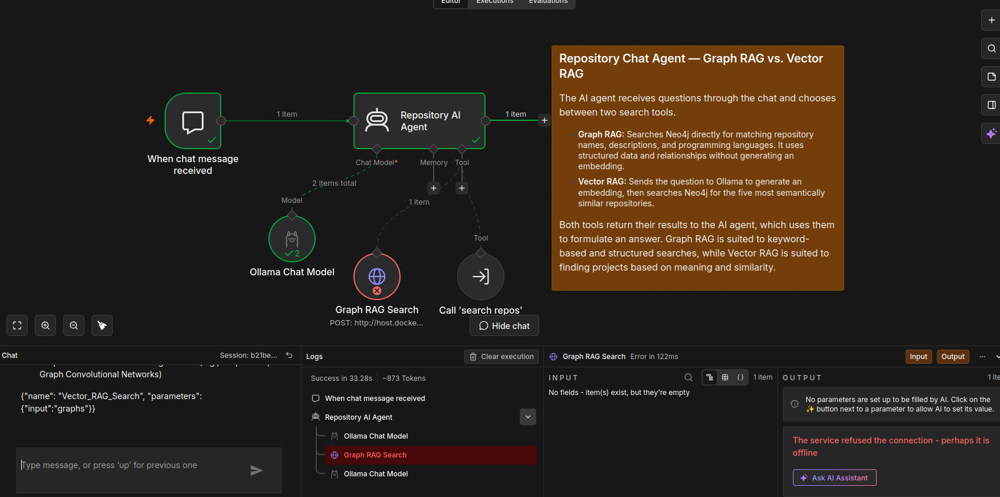

# RepoAgent

RepoAgent is an AI repository assistant built with n8n, Neo4j and Ollama. It combines Graph RAG and Vector RAG to find relevant repositories based on their metadata and semantic similarity.

## Embed



The workflow retrieves public repositories from the GitHub API:

`https://api.github.com/users/nikholt1/repos`

It filters repositories that have a description and programming language, then merges them with a hardcoded list of private repositories that cannot be retrieved through the public API.

The data is normalized into a consistent format containing the repository name, description and languages.

**Graph RAG:** The workflow connects to Neo4j and creates `Repository` and `Language` nodes, connecting them through `USES_LANGUAGE` relationships.

**Vector RAG:** The workflow sends the repository information to Ollama using `nomic-embed-text`. Ollama generates a 768-dimensional embedding, which is stored on the corresponding repository node in Neo4j.

Workflow: [`graphAndVectorEmbedding.json`](graphAndVectorEmbedding.json)

## Agent



The agent has a system prompt requiring it to attempt both search tools before answering:

- **Graph RAG Search:** Connects directly to Neo4j and searches repository names, descriptions and programming languages.
- **Vector RAG Search:** Calls the published `search repos` workflow to embed the question and retrieve semantically similar repositories.

The system prompt also instructs the agent to use the retrieved results, avoid inventing repository information, and disclose when a search fails or returns insufficient information.

Workflow: [`embedAgent.json`](embedAgent.json)

## Published workflow — Vector search



When the agent calls the Vector RAG tool, it passes the user's question to the published `search repos` workflow.

The workflow sends the question to Ollama using `nomic-embed-text` and validates that the resulting embedding contains 768 values.

It then queries Neo4j's `repository_embedding_index` and retrieves the five closest repository matches based on vector similarity. The results are formatted and returned to the agent.

Workflow: [`publishedSearchRepos.json`](publishedSearchRepos.json)


## Data sources and Neo4j

### Data sources

- **Public GitHub repositories:** Retrieved from the GitHub API for `nikholt1`. Only repositories with a description and programming language are included.
- **Private repositories:** A hardcoded list in the ingestion workflow containing `Magistra3.0`, `TraceAI`, `RAG-Project` and `Self-Hosted-AI`.
- **Ollama:** Generates repository and query embeddings locally using `nomic-embed-text`, and provides the chat model `Llama3.2:latest`.
- **Neo4j:** Stores repository metadata, language relationships and embeddings.

### Graph relationships



The graph uses two node types:

- `Repository`: stores the repository name, description, languages and embedding.
- `Language`: stores programming language names.

Each repository connects to its languages through `USES_LANGUAGE` relationships.

### Vector embeddings



Each repository has an `embedding` property containing 768 numerical values. The vector index `repository_embedding_index` is used to find repositories similar to an embedded query.

## Examples
1. Small prompt causes error
When the prompt is too small, it seems like the agent fails to retrieve the GRAPH RAG, for some reason it does not see the necessity to call the VECTOR RAG at all.
The error message states that the database might be offline, and i get a error code 400.



## Setup

1. Start Neo4j and Ollama.
2. Pull the required models:

   ```bash
   ollama pull llama3.2
   ollama pull nomic-embed-text
   ```

3. Import the three workflow JSON files into n8n.
4. Configure the Ollama and Neo4j connections and verify the database endpoint.
5. Create and verify the Neo4j vector index `repository_embedding_index` with 768 dimensions and cosine similarity.
6. Run the embedding workflow to populate the graph and embeddings.
7. Activate the workflows and test the agent through the n8n chat interface.

**Note:** Configure credentials securely in n8n before sharing or publishing workflow exports. The workflow endpoints and credentials may need to be adjusted for another environment.
